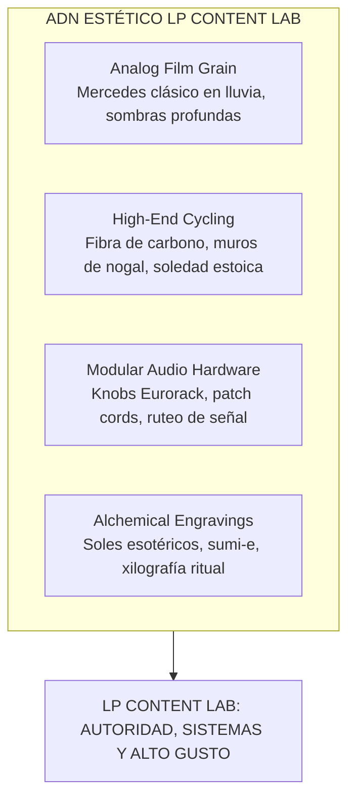

# BRAND BOOK: LP CONTENT LAB ⚡👁️
### *Sistemas de Contenido, Orquestación Multi-Agente y Repurposing de Alto Rendimiento*
**Vertical Oficial de LP & Co.**  
*Fundador & Systems Architect:* **Diego Lecourtois Palencia**  
*Credenciales de Autoridad:* Co-Founder @ Mr. Lock (+2,500 cerraduras IoT activas en Riviera Maya y GDL) · Founder @ BiciSaaS · Partner @ Mr. Wood  
*Perfil Ejecutivo:* [Diego Lecourtois Palencia en LinkedIn](https://www.linkedin.com/in/diego-lecourtois-palencia-378a431a5/)  
*Ubicación:* Cancún / Riviera Maya, Quintana Roo, México (`21.16° N · 86.85° W`)  
*Edición:* Octubre 2026  

---

```
             ┌─────────────────────────────────────────────────────────┐
             │                      LP & CO.                           │
             │   Firma Boutique de Sistemas, IA & Automatización       │
             │             (Diego Lecourtois Palencia)                 │
             └────────────────────────────┬────────────────────────────┘
                                          │
                         ┌────────────────┴────────────────┐
                         ▼                                 ▼
              [ SISTEMAS & HARDWARE ]             [ LP CONTENT LAB ]
           Mr. Lock (+2,500 IoT) · Mr. Wood    Laboratorio de Contenidos B2B
              BiciSaaS (ERP Ciclismo)            Orquestación Multi-Agente
```

---

## 1. EL MANIFIESTO: LA FILOSOFÍA LP CONTENT LAB

> *"No ves todo lo que es. Ves lo que puedes reconocer."*  
> *"Manifestar no es magia. Es física y sistemas."*  
> *"Persigue la visión, no la aprobación."*  
> *"Oakley no fue creada para ser moda. El Lab no fue creado para ser una agencia más."*

### La Tesis Central: De "Agencia de Marketing" a "Laboratorio de Infraestructura"
El 99% de las agencias de contenido venden humo: plantillas idénticas en Canva, subtítulos chillones con emojis infantiles, y textos genéricos redactados por IA barata (*"En el dinámico mundo de hoy..."*). Tratan el contenido como una ruleta de vanidad algorítmica y persiguen métricas vacías.

**LP Content Lab opera bajo la tesis de ingeniería de Diego Lecourtois Palencia:**
Para un fundador técnico, un desarrollador inmobiliario de la Riviera Maya o un directivo B2B, **el contenido no es entretenimiento; es una infraestructura patrimonial**. Es un activo de alto rendimiento que documenta criterio, atrae capital institucional y construye reputación sin exigir que el fundador se convierta en esclavo de las redes sociales.

Si en Mr. Lock instalamos más de 2,500 cerraduras IoT para blindar propiedades desde los planos con desarrolladoras líderes como Grupo VEQ, **en LP Content Lab instalamos sistemas que blindan la autoridad digital del fundador desde sus propias grabaciones y criterio.**

### Las Cuatro Raíces Culturales

#### 1. El Estoicismo del Ciclista (Endurance & Discipline)
*Inspirado en la soledad de la carretera abierta, el puerto de montaña, el entrenamiento antes del amanecer y la frase "Si fallo, vuelvo a intentar".*  
* El contenido orgánico es como una etapa reina de 160 kilómetros: no se gana con arranques emocionales ni trucos rápidos; se gana pedaleando a un ritmo constante, subiendo el puerto sin quejarse y sosteniendo el sistema en el tiempo.
* **"Art of Not Reacting":** No nos desesperamos por los picos de dopamina de las métricas vanidosas. Construimos presencia que intimida por su consistencia.

#### 2. La Alta Carpintería y el Tacto Material (MR Wood DNA)
*Inspirado en el nogal oscuro, los herrajes de latón cepillado, los gabinetes a medida y el amor por la materia prima noble.*  
* Aunque utilizamos inteligencia artificial de última generación, el resultado debe sentirse **físico, pesado, cálido y analógico**.
* Como una bicicleta de ruta colgada sobre un panel de madera oscura iluminada por spots de riel: cada pieza entregada por el Lab tiene terminaciones de alta costura, proporciones cuidadas y sobriedad ejecutiva.

#### 3. El Sintetizador Modular y el Enjambre Multi-Agente (Tactile Cybernetics)
*Inspirado en módulos Eurorack (Behringer 297), cables de conexión cruzada (patching), perillas mecánicas y la orquestación en chat de agentes especializados (`@Media Buyer`, `@Creative Director`, `@CRO`, `@Ghostwriter`).*  
* No somos un "freelancer con ChatGPT abierto". Somos un **laboratorio de señales y flujos**. Conectamos la materia prima en audio/video del cliente a un enjambre de subagentes especializados, calibrados y filtrados por la supervisión humana con criterio.

#### 4. La Metanoia y la Búsqueda Trascendente
*Inspirado en el grabado alquímico: "First, you're the fool. Then, you're the magician", el sol con tres ojos y el paso de niño quebrado a hombre restaurado.*  
* Reconocemos que el trabajo del creador implica una transformación interna. El contenido no es solo marketing; es la proyección de la cosmovisión y el intelecto de un líder.

---

## 2. ARQUITECTURA DE MARCA: LP & CO. → LP CONTENT LAB

| Parámetro | Marca Matriz: LP & Co. | Vertical: LP Content Lab |
| :--- | :--- | :--- |
| **Definición** | Firma boutique de automatización de marketing y sistemas de operación. | Laboratorio de ingeniería de contenidos y reputación digital para directivos. |
| **Público Objetivo** | Negocios tradicionales de la Riviera Maya con caos operativo. | Fundadores, firmas inmobiliarias, cirujanos y creadores B2B de alto ticket. |
| **Rol de Diego** | Arquitecto de Sistemas & Socio Estratégico. | Director del Laboratorio & Curador Jefe de Señal. |
| **Promesa** | *"Sistemas que quitan el caos."* | *"Convierte tu conocimiento en un enjambre de activos digitales."* |
| **Vehículo Técnico** | Supabase, PostgreSQL, APIs, WhatsApp Bots. | Orquestación de Agentes LLM, Whisper, Opus Pro, Ghostwriting B2B. |

---

## 3. IDENTIDAD VISUAL Y DIRECCIÓN DE ARTE

```
┌────────────────────────────────────────────────────────────────────────┐
│                          PALETA CROMÁTICA                              │
├─────────────┬─────────────┬─────────────┬─────────────┬────────────────┤
│   OBSIDIAN  │  RAW WALNUT │  ALCHEMICAL │ CHALK WHITE │  SIGNAL OCHRE  │
│   #050505   │   #281E19   │   #681016   │   #EDEDE8   │    #C99A45     │
│  Fondo base │ Madera noble│ Nobleza/Foco│ Tipografía  │  Knobs / Ticks │
└─────────────┴─────────────┴─────────────┴─────────────┴────────────────┘
```

### Paleta de Colores

1. **Obsidian Black (`#050505` / `#000000`):**  
   Heredado del sitio matriz de LP & Co. Oscuridad total, contraste máximo, cero ruido. El fondo donde la señal destaca.
2. **Raw Walnut / Madera de Nogal (`#281E19` / `#1C1512`):**  
   Tomado del ADN de MR Wood. Evoca calidez noble, paneles acústicos de estudio, cuero añejo y talleres artesanales. Rompe la frialdad del software genérico.
3. **Alchemical Crimson / Sangre de Toro (`#681016` / `#80141A`):**  
   Inspirado en la placa *"Persigue la visión, no la aprobación"* y los grabados de tarot/alquimia. Se utiliza para acentos de alta tensión, botones de acción clave y llamados de atención precisos.
4. **Chalk Off-White (`#EDEDE8` / `#F5F5F0`):**  
   Blanco hueso con tono de papel editorial y libros clásicos. Elimina el blanco digital estridente (`#FFFFFF`) para generar una experiencia de lectura serena y sofisticada.
5. **Signal Ochre / Latón Técnico (`#C99A45` / `#D4AF37`):**  
   Inspirado en las perillas de sintetizadores analógicos, los rayos del sol esotérico y las coordenadas geográficas de Cancún.

### Tipografía del Sistema

```
DISPLAY:       Michroma / Cinzel Bold
EDITORIAL:     Instrument Sans (400, 500, 600)
TELEMETRÍA:    IBM Plex Mono (400, 500)
```

1. **Titulares de Marca y Secciones:**  
   * **Michroma:** Geometría retrofuturista, técnica, de precisión aeroespacial (marca matriz).
   * **Cinzel / Serif Editorial (Uso Selectivo):** Para sentencias contrarias, aforismos estoicos y frases de manifiesto que requieran peso filosófico.
2. **Cuerpo de Texto y Ensayos:**  
   * **Instrument Sans:** Humanista, geométrica pero accesible, excelente legibilidad en pantalla Retina de móvil.
3. **Metadatos, Agentes y Códigos de Sistema:**  
   * **IBM Plex Mono:** La voz del sistema. Se utiliza para marcar timestamps, etiquetas de agentes (`@Creative_Director`), números de lote (`LOTE_01 / SEMANA_42`) y métricas financieras.

---

## 4. IMAGINARIO VISUAL Y ESTÉTICA (THE MOODBOARD)



### Elementos Gráficos Prohibidos vs. Mandatorios

> [!CAUTION]
> **Lo que NUNCA verás en LP Content Lab (Anti-Slop):**
> * Degradados violeta/azul pastel típicos de startups de Silicon Valley.
> * Personajes 3D inflados genéricos o avatares de cómic corporativo.
> * Emojis excesivos al inicio de cada línea (🚀🔥👇).
> * Textos inflados con adjetivos vacíos (*"revolucionario", "fascinante", "en la era digital"*).
> * Ilustraciones de manos flotantes o vectores planos de banco de imágenes.

> [!TIP]
> **Elementos Mandatorios que definen la marca:**
> * Grano fotográfico sutil (35mm / Tri-X 400).
> * Líneas técnicas de retícula (grid de 1px con opacidad de 10% a 20%).
> * Enmarques con esquinas estilo visor de cámara técnica (`+` en vértices).
> * Diagramas de enrutamiento tipo sintetizador modular (inputs $\rightarrow$ transformadores $\rightarrow$ outputs).
> * Fotografía en blanco y negro con punto focal contrastado.
> * "Oakley Overthetop mindset": Cada elemento visual tiene una justificación funcional estricta; nada es adorno por moda.

---

## 5. LA VOZ Y EL TONO: EL GHOSTWRITING DE ALTA JERARQUÍA

### Personalidad de Marca
* **El Cirujano / El Operador Silencioso:** Habla con la calma de quien ya probó los números en la práctica.
* **El Estoico Rebelde:** Reconoce la fricción, el sudor y el cansancio de operar negocios reales, pero no se detiene a compadecerse.
* **Directo y Anti-Hype:** Prefiere decir *"Cerramos 2 clientes con este script"* antes que *"Descubre el secreto infalible para monetizar millones"*.

### Comparativa de Redacción

| Enfoque Tradicional de Agencia | Enfoque LP Content Lab |
| :--- | :--- |
| *"¡Convierte tus videos aburridos en reels virales que exploten el algoritmo! 🔥📈"* | *"Tu video de 45 minutos contiene 3 lecciones de alto ticket. Las extraemos, las pulimos y las convertimos en activos de retención para LinkedIn y video vertical."* |
| *"Somos un equipo de creativos apasionados por el storytelling digital..."* | *"Orquestamos un enjambre de agentes de IA entrenados en tu voz, supervisados por directores con criterio humano. Cero tareas manuales. Cero clichés."* |
| *"Agenda una llamada estratégica totalmente gratis aquí abajo 👇"* | *"Te preparamos una muestra terminada de tu último episodio. La descargas y la publicas hoy. Si los números te hacen sentido, hablamos 10 minutos."* |

---

## 6. ESPECIFICACIONES PARA EL NUEVO SITIO WEB (ROADMAP)

### Estructura de la Landing Page de LP Content Lab

1. **Header:**  
   Logomarca `LP & Co. / Content Lab` + Switcher de navegación (`Firma Matriz` / `Content Lab` / `Portafolio`).
2. **Hero Section:**  
   * Hook tipográfico contundente en `Michroma`:  
     `INFRAESTRUCTURA DE CONTENIDO PARA QUIENES NO TIENEN TIEMPO DE SER INFLUENCERS.`
   * Sub-lead en `Instrument Sans`:  
     *Transformamos tus grabaciones, podcasts y reuniones en un enjambre continuo de clips verticales y ensayos de LinkedIn. Sin que toques un editor de video.*
   * CTA dual en `IBM Plex Mono`: `[ SOLICITAR MUESTRA DE PRUEBA → ]` `[ VER CASO DE ESTUDIO ]`.
3. **El Problema (La Trampa del Creador Tradicional):**  
   Comparativa interactiva entre el creador cansado (12 hrs/semana peleando con Premiere y Canva) vs. el Fundador con LP Content Lab (1 hr de grabación $\rightarrow$ 16 piezas terminadas).
4. **El Motor Multi-Agente (Behind the Machine):**  
   Demostración interactiva visual de cómo fluye el contenido:  
   `Video Largo` $\rightarrow$ `@Lead_Scout` $\rightarrow$ `@Creative_Director` $\rightarrow$ `@Ghostwriter` $\rightarrow$ `Revisión Diego` $\rightarrow$ `Drive del Cliente`.
5. **El Tabulador de Tiers (Sin rodeos de precios ocultos):**  
   * **Sprint Starter ($499 USD/mes):** 12 Clips verticales + 4 Ensayos LinkedIn.
   * **Full Omnichannel ($899 USD/mes):** 16 Clips verticales + 8 Ensayos LinkedIn + Newsletter Semanal.
6. **El Caballo de Troya (Lead Magnet Funcional):**  
   Formulario simple: *"Pega el link de YouTube de tu último video o podcast. En 24 horas te entregamos tu primer clip vertical y post de LinkedIn listos para publicar."*
7. **Footer Técnico:**  
   `LP Content Lab · Quintana Roo, México · 21.16° N 86.85° W · Una vertical de LP & Co.`

---
*Fin del Brand Book — Documento vivo para el desarrollo del sitio web y la producción de activos.*
